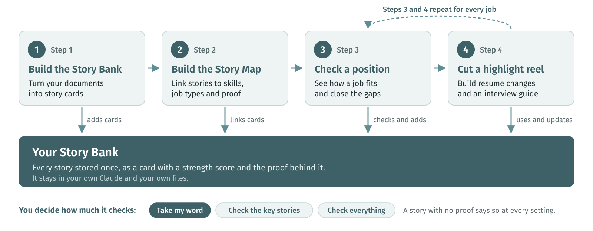

# Career Track Record

Bank your career stories with proof. Check any job against them.

A four-step Claude plugin that captures and sharpens your career stories, then
validates each one against a document, a public source, or a named person, so
you can prepare for job opportunities, write a book or bio, and tell your
story.

Built with Claude. This is an independent project and is not affiliated with or
endorsed by Anthropic.



## Who it is for

People with a long career and thin records of what they did. If you have
twenty years of work and a two-page resume, most of your evidence lives in your
head. This workflow gets it out, checks it, and keeps it in one place.

## The four steps

| Step | Skill | What it does | What you get |
|---|---|---|---|
| 1 | `build-story-bank` | Loads your resumes, bios and other documents, drafts story cards, and fills the gaps in a 15-minute guided session per story | A bank of story cards, each with proof |
| 2 | `build-story-map` | Links every story to the skills it proves, the job types it fits and the proof behind it | A story map (an ontology), target job types, a Core Reel |
| 3 | `check-a-position` | Scores a posting against your bank, finds the gaps, and closes them by capturing a story you already have or planning training | A fit check, new or updated stories, a decision |
| 4 | `cut-highlight-reel` | Picks the 5 to 7 stories for one job and builds from them | Resume changes, an interview guide, a debrief |

Steps 3 and 4 repeat for every position. The bank and the map get stronger each
time.


## Three rules the workflow follows

1. **It never invents experience.** Every line traces to a story card. If the
   bank cannot support a claim, the claim is left out.
2. **A story needs proof.** A card is validated only with a document, a public
   source you confirm, or a named person who can back it up.
3. **The fit check is honest.** It states weaknesses as plainly as strengths.

In practice this tends to make a resume more accurate, not more inflated:
"built" becomes "helped build" when that is what happened.

## Install

This is a standard Claude plugin: a manifest in `.claude-plugin/plugin.json`
and four skills under `skills/`.

- **Claude Code:** clone this repository and start Claude Code with
  `claude --plugin-dir ./career-track-record`.
- **Claude apps:** see Anthropic's plugin documentation for adding a plugin:
  https://code.claude.com/docs/en/plugins

## Use

Start a conversation and say what you want in plain words:

- "Build my story bank." Then share your resume and other documents.
- "Build my story map."
- "Check this job." Then paste the posting.
- "Cut a highlight reel for this job."

## Your data

Your story bank is a folder of plain text files in your own workspace:

```
story-bank/
├── cards/         one file per story card
├── story-map.md
├── positions/     one file per position checked
└── reels/         highlight reels
```

Nothing is sent anywhere by this plugin. Career stories often contain employer
or client figures. Check what is public or cleared before you record or share
them.

## Using AI in job applications

Check each employer's policy on using AI in applications. This workflow is
built for the common rule: your experience and your first draft are your own,
and AI helps you find, check and sharpen them.

## Status

Version 0.1.3. The author built this and uses it for his own job search. It has
been through three simulated test runs and has not yet been tested by many
people. Feedback and corrections are welcome
through Issues.

## License

MIT. See [LICENSE](LICENSE).
