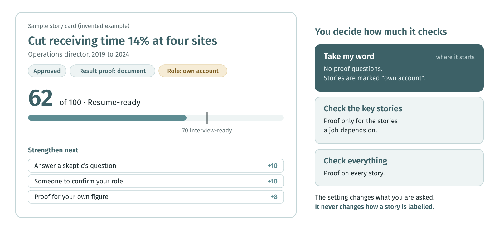
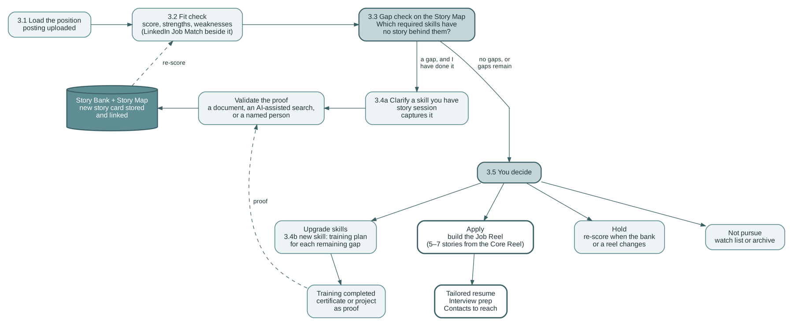

# Career Track Record

**Bank your career stories with proof. Check any job against them.**

A four-step Claude plugin that captures and sharpens your career stories, then
validates each one against a document, a public source, or a named person, so
you can prepare for job opportunities, write a book or bio, and tell your
story.

Version 0.1.6 · MIT license · Built with Claude. This is an independent
project and is not affiliated with or endorsed by Anthropic.


## Contents

- [Who it is for](#who-it-is-for)
- [What you get](#what-you-get)
- [The four steps](#the-four-steps)
- [How it treats proof](#how-it-treats-proof)
- [Depth and score](#depth-and-score)
- [What you need](#what-you-need)
- [Install](#install)
- [Use](#use)
- [Your data](#your-data)
- [Status and feedback](#status-and-feedback)

## Who it is for

People with a long career and thin records of what they did. If you have
twenty years of work and a two-page resume, most of your evidence lives in your
head. This workflow gets it out, checks it, and keeps it in one place.

## What you get



- **A story card for each accomplishment,** with a strength score from 0 to
  100, the proof behind it, and the two or three things that would raise the
  score most.
- **A fit check for any job posting** that counts what you can match and what
  you can prove, separately, and names the gaps plainly.
- **Resume changes and an interview guide** built only from your own stories.
  Each draft ends with "Check these words": a list of any wording that is not
  in your stories, for you to confirm or strike.
- **A spreadsheet of your bank,** if you ask for one.

## The four steps

| Step | Skill | What it does | What you get |
|---|---|---|---|
| 1 | `build-story-bank` | Reads your resumes, bios and other documents, drafts story cards, and fills the gaps in a short guided session for each story | A bank of story cards, each with a score |
| 2 | `build-story-map` | Links every story to the skills it shows, the job types it fits and the proof behind it | A story map (an ontology) and target job types |
| 3 | `check-a-position` | Rates a posting against your bank, finds the gaps, and closes them by capturing a story you already have or planning training | A fit check, new or updated stories, a decision |
| 4 | `cut-highlight-reel` | Picks the stories for one job and builds from them | Resume changes, an interview guide, a debrief |

Steps 3 and 4 repeat for every position. The bank and the map get stronger
each time. Each step is made of short parts, and at the end of each part
Claude says what was done and what comes next, and you choose whether to go
on.



## How it treats proof

Three rules hold at every step.

1. **It never invents experience.** Every line traces to a story card. If the
   bank cannot support a claim, the claim is left out.
2. **It never claims proof it does not have.** A story is marked validated
   only with a document, a public source you confirm, or a named person who
   can back it up. A named person is shown as "named, not contacted" until
   they agree to confirm. A story without proof is marked "own account".
3. **The fit check is honest.** It states weaknesses as plainly as strengths,
   and a rating rises on what is written on a card, never on a yes.

In practice this tends to make a resume more accurate, not more inflated:
"built" becomes "helped build" when that is what happened.

### You decide how much it checks

| Setting | What you are asked | When to use it |
|---|---|---|
| **Take my word** (where it starts) | No proof questions. Stories are recorded as you tell them and marked "own account". | Getting your stories down |
| **Check the key stories** | Proof only for the stories that back a must-have for a job, or that you plan to tell in an interview | An employer is likely to check references or ask for proof |
| **Check everything** | Proof on every story | A book, a public post, or a senior search |

Change the setting at any time by saying its name. The setting changes what
you are asked. It never changes how a story is labelled: a story with no
proof says so at every setting.

## Depth and score

Not every story needs the same work. A story you might mention while
networking needs less than one you will tell in a final-round interview.

- **Depth.** Each story gets a session sized to its use: Quick (up to 4
  questions), Standard (up to 7) or Deep (up to 10). Claude suggests a depth
  from where you are in your search, and you can change it. It asks the
  questions that matter most first and stops when the story is strong enough
  for its use. Depth changes how much is asked, never the accuracy rules.
- **Score.** Each story gets a score and a band: Starter, Resume-ready,
  Interview-ready or Proven. Proven needs a document, a public source, or a
  named person who has agreed to confirm.
- **Strengthen later.** Come back in any conversation, say "strengthen card
  08", and Claude asks only the items that would raise that card's score.

## What you need

- **A paid Claude plan.** Plugins are available on Pro, Max, Ultra, Team and
  Enterprise plans. They are not available on the free plan.
- **Claude on the web or the Claude desktop app,** or Claude Code version
  2.1.273 or later. This plugin has not been tested on the mobile apps.
- **For the spreadsheet:** a Claude that can create files or sheets. Without
  that, you get the same tables in the conversation to paste into your own
  spreadsheet.
- **On a Team or Enterprise plan,** your administrator may limit which plugins
  you can add.

Tappable choices, the drawn card view and the spreadsheet depend on what your
Claude can do. Where one is not available, the plugin falls back to plain text
and the workflow is the same.

Plans and app versions change. Anthropic's current guide is
[Use plugins in Claude](https://support.claude.com/en/articles/13837440-use-plugins-in-claude).

## Install

**Claude on the web or desktop**

1. Download `career-track-record.plugin` from this repository.
2. In Claude, open Customize, then Plugins, and upload the file.
3. Start a new conversation and ask: "Which version of Career Track Record are
   you using?" It should answer 0.1.6.

If Claude says the skills are not available, the plugin is not turned on for
your account yet.

**Claude Code**

Clone this repository and start Claude Code with
`claude --plugin-dir ./career-track-record`.

## Use

Start a conversation and say what you want in plain words:

- "Build my story bank." Then share your resume and other documents.
- "Build my story map."
- "Check this job." Then paste the posting.
- "Cut a highlight reel for this job."
- "Strengthen card 03."
- "Give me the spreadsheet."

## Your data

- **The plugin has no server and collects nothing.** It is a set of
  instructions for Claude. Nothing you enter is sent to the author or to any
  third party by this plugin.
- **Your story bank stays with you.** It is saved as plain text files in the
  folder you work in with Claude:

  ```
  story-bank/
  ├── settings.md       how much to check, target job types, default depth
  ├── cards/            one file per story card
  ├── story-map.md
  ├── positions/        one file per position checked
  ├── reels/            highlight reels
  └── story-bank.xlsx   optional spreadsheet, built only if you ask
  ```

  If you use Claude without a working folder, your stories stay in your
  conversation and you save them yourself. Claude gives you a short index to
  save with them, so a later conversation can pick up where you stopped.
- **Claude still processes what you share.** As with anything you do in
  Claude, your documents and answers are handled under your own Claude plan
  and privacy settings. This plugin does not change that.
- **Confidential figures are tracked.** Career stories often contain employer
  or client figures. A figure you mark as not cleared is kept out of every
  resume, guide and post. A figure you have not yet cleared appears only in a
  draft, under "Confirm before sending".

## Using AI in job applications

Check each employer's policy on using AI in applications. This workflow is
built for the common rule: your experience and your first draft are your own,
and AI helps you find, check and sharpen them. The plugin does not write cover
notes or application answers from scratch. It asks for your draft and refines
it.

## Status and feedback

Version 0.1.6. The author built this and uses it for his own book, speaker bios and resume. Each
of the four steps has been through simulated test runs with invented
candidates, and Step 1 has had one run on a real career. It has not yet been
tested by many people, and the screen features (tappable choices, the card
view and the spreadsheet) have had the least testing.

Feedback and corrections are welcome through
[Issues](../../issues). The history of changes is in
[CHANGELOG.md](CHANGELOG.md).

## License

MIT. See [LICENSE](LICENSE).
